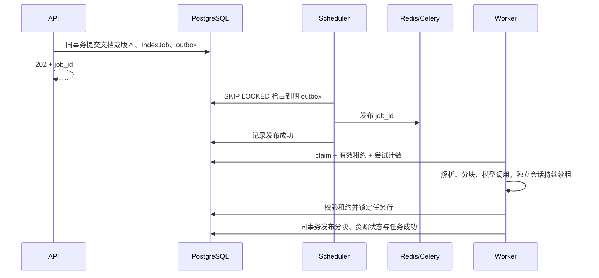

# 架构与扩展

RAG-Center 使用异步模块化单体。API 负责 HTTP 和凭据解析，业务服务管理事务，仓储管理查询与 flush，Provider 管理外部服务。跨模块通过公开服务及 DTO 交换数据。

```text
Backend/src/rag_center/
  api/                    HTTP 依赖、健康检查及 v1 路由
  core/                   配置、资源容器、日志、指标、诊断
  infrastructure/         异步数据库、HTTP、存储、观测、Provider
  modules/
    tenants/              租户、凭据、套餐、配额及限流
    knowledge_bases/      知识库
    documents/            文档、解析及分块
    indexing/             版本、任务、outbox、租约和索引发布
    retrieval/            检索及融合
    research/             受控规划、并发检索与证据编排
    feedback/             反馈与 trace 权属核验
  config/base.yaml        包内默认配置
  migrations/             随 wheel 分发的迁移
  evaluation/             正式评测代码
  cli/                    唯一命令入口
```

## 资源生命周期

`create_app(settings=None)` 支持注入配置，lifespan 创建并关闭数据库连接池、Redis、HTTP 和可选 Langfuse。导入服务模块不建立外部连接。请求使用独立 AsyncSession；业务提交或回滚事务。解析和分块由有界线程池执行。

Research 每个并发分支通过 `RagService.retrieval_branch()` 创建独立 AsyncSession。知识库通过 `KnowledgeBaseView` 快照跨分支传递。模型调用前释放仅用于身份和版本查询的数据库事务。

Celery 使用 prefork；每个子进程惰性创建持久事件循环与资源容器，连续任务复用连接池，每个任务独占会话。关闭子进程时释放资源。

## 可靠任务与发布



任务状态为 queued、running、succeeded、failed。`available_at` 表示可执行时间，`lease_expires_at` 只表示运行租约。暂时性错误最多尝试三次，按基础退避乘以 `2^(attempt-1)` 重试；永久错误首次就进入失败终态。重试和过期恢复在同一事务补建 outbox。发布后长期 queued 的任务会再次投递，数据库 claim 保证重复消息不会并行执行。

每个任务尝试使用独立代次，分块 UUID 由任务 ID、尝试序号、文档、版本和块序号确定。解析和 embedding 的中间数据保留在内存，PostgreSQL 产物仅在有效租约保护的发布事务中写入。Elasticsearch 先接收独立 ID 的代次，BM25 结果按 PostgreSQL 中已发布 ID 再次过滤。旧 Worker 的代次不能覆盖新代次，调度器分批清理过期且未发布或已替换的 ES 产物，有效租约的准备中代次受保护。重新索引完成前继续保留此前已发布分块。

版本构建、激活和文档修改通过知识库行锁串行协调。存在 processing 文档时不建立版本快照；building 版本阻止文档修改。并发激活只保留一个 active 版本，并与知识库当前版本指针在同一事务中更新。

## 扩展 Provider 与模块

新增 Provider 时实现 `infrastructure/providers/<能力>/base.py` 的契约；构造函数只接收配置和共享 HTTP 客户端，不在构造或导入阶段探测外部服务。在容器或业务组装点注入实现，覆盖协议错误、超时和降级行为。数据库 Provider 使用传入会话，不持有全局会话。

新增业务模块按 models、repositories、schemas、services 分层。需要持久化变化时追加迁移；API 使用类型化 `ApiResponse[T]`，重新导出 OpenAPI 并生成前端类型。新增后台工作继续使用任务 ID 消息、outbox 和租约发布，禁止直接在 API 提交事务后调用 Celery 作为唯一投递路径。
